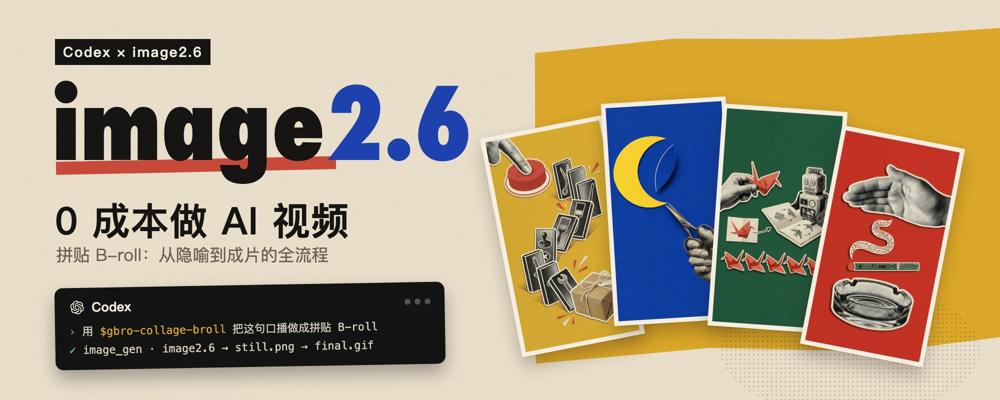
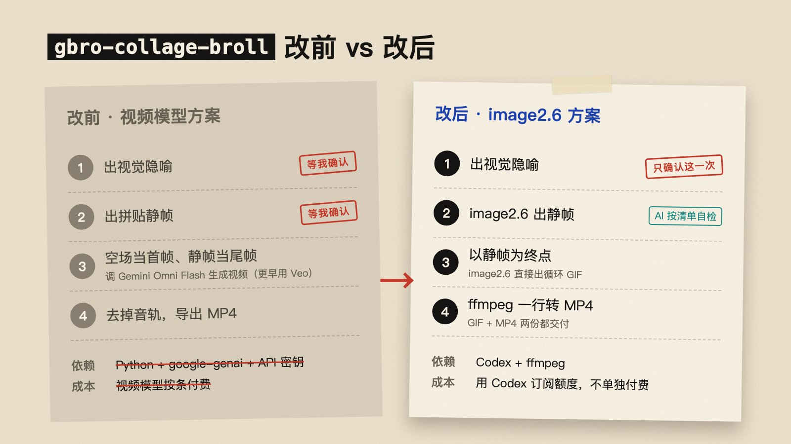
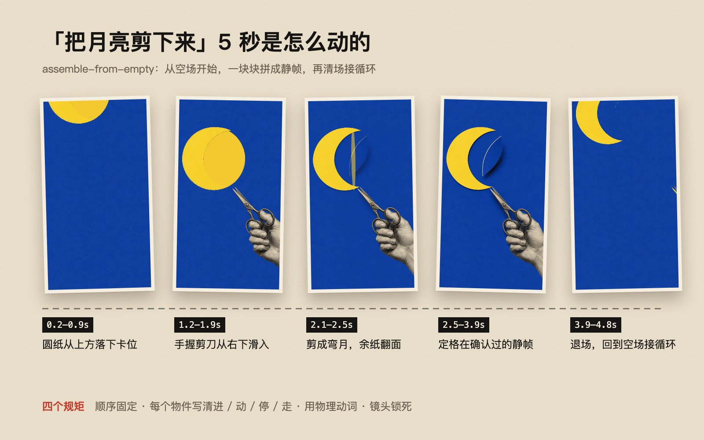
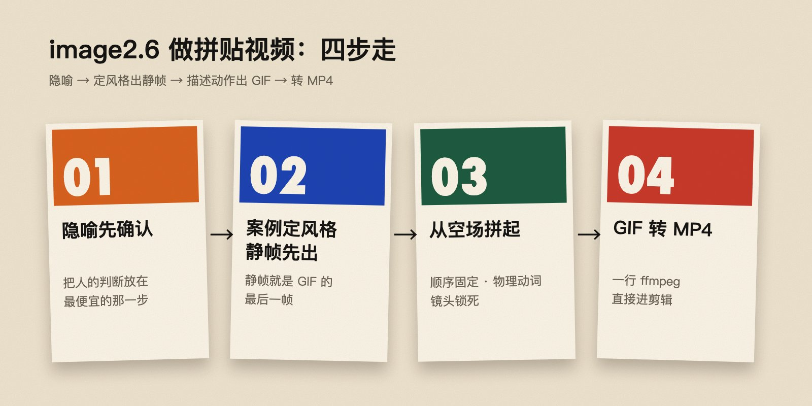
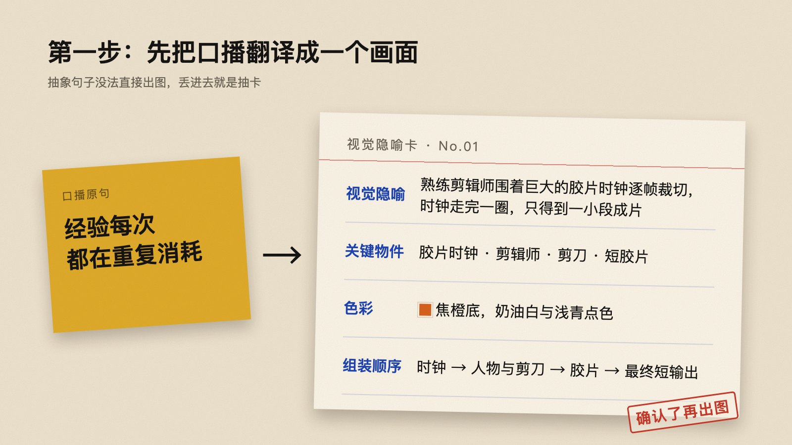
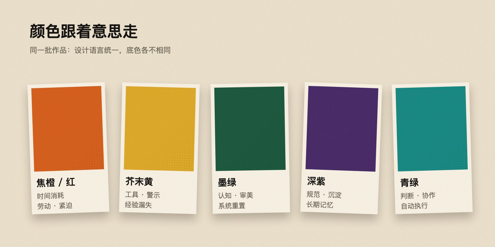
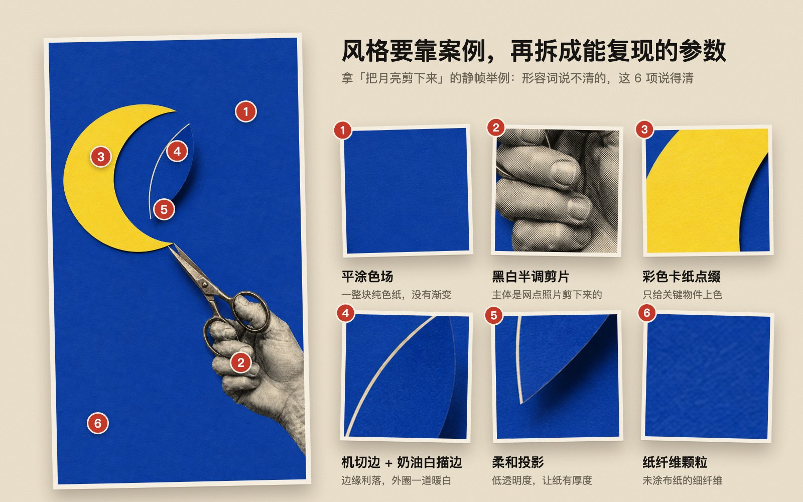

> 本文根据 [gbroai 在 X 发布的长文](https://x.com/gbroai/status/2118589683819262346)整理。作者展示了把约 5 秒口播转成半调纸拼贴 B-roll 的个人流程，并称其在 Codex 订阅额度内完成、没有调用视频生成模型。这是作者当时的工具与额度体验，不代表所有账号都能零边际成本使用；模型能力、订阅权益和可用入口也可能变化。作者提到的新版 Skill 当时仍在调试，开源仓库公开版本可能尚未包含文中流程。



把一段口播做成有手工质感的镜头，难点不是单纯“让模型动起来”，而是先把抽象语句翻译为可读的画面，再稳定视觉语言，最后约束动画只完成一件事。gbroai 的实践把流程压缩为：

```text
确认视觉隐喻 → 定风格并生成静帧 → 描述组装动作并生成 GIF → 转成 MP4
```

关键想法是让人只在最需要判断的地方停下来：先审隐喻；风格、构图和假字等问题交给规则清单检查；GIF 则以已确认的静帧为目标画面。

## 从视频模型切换到静帧驱动的 GIF

作者原来的做法是先确认视觉隐喻，再确认静帧，接着将纯色空场作为首帧、静帧作为尾帧，调用视频模型补间，最后去掉音轨。调整后的流程保留一次人工确认：图像模型按风格规范生成静帧并自检，再以静帧为终点生成循环 GIF，最后转成 MP4。

| 环节 | 原做法 | 调整后 |
| --- | --- | --- |
| 人工确认 | 隐喻与静帧分别确认 | 主要确认视觉隐喻 |
| 动态生成 | 视频模型根据首尾帧补间 | 图像模型从空场逐块组装为 GIF |
| 依赖 | Python、模型 SDK、API 密钥及视频模型 | Codex 与 ffmpeg；具体生成入口依账号能力而定 |
| 输出 | 去音轨后的 MP4 | GIF 与 MP4 两份 |

这并不意味着 GIF 对所有视频任务都合适。它适用于短时长、循环播放、画面主体可以拆成少量纸片的镜头；复杂连续运动、真实摄影机运动、长片段和同步音频仍需要其他制作方式。



## 第一步：把口播翻译成一个隐喻

口播通常是抽象概念，直接把句子交给生成模型，容易得到随机但不聚焦的图。先把它改写成一个观众一眼能读懂的物理场景。例如，“经验每次都在重复消耗”可以转成一只手不断从纸上剪下相同形状；“规范沉淀”可以转成散落的卡片逐渐装订成册。

隐喻确认值得保留为人工检查点，因为它决定后续镜头是否表达正确。相较于重做多张图和动画，审阅一句话的成本更低。

- 一句话只表达一个隐喻，不让同一镜头讲三件事。
- 控制在 3–6 个主要物件，保证主体可识别，也给动画留下清晰层次。
- 不把口播文稿直接塞进画面；让画面解释隐喻，字幕负责文字。
- 批量制作时安排镜头之间的叙事关系，让单条 B-roll 服务于整段内容。

## 第二步：先定视觉规范，再生成静帧

“杂志拼贴风”“高级质感”一类形容词很难稳定复现。作者的做法是先提供一张具体风格参考，再将它拆成可重复的视觉参数，例如保存为项目内的 `visual-spec.json`。文件格式是工作流建议，并非该作者公布的固定规范。

一份可执行的拼贴规范可以写清：

- 背景是一块均匀、无渐变的纯色纸面。
- 主体采用黑白半调照片剪片，保留明显的印刷网点。
- 彩色卡纸只强调少数关键物件，而不是让所有元素都抢眼。
- 纸片边缘清晰，带细窄的暖白描边和轻柔投影。
- 保留轻微纸纤维颗粒，避免抛光塑料或光滑 3D 质感。

参考图让模型与创作者看到同一个风格目标，参数化规范则帮助同一批镜头保持一致。颜色还可以承担语义：暖红橙色可用于劳动或紧迫，黄色可用于工具或警示，绿色可用于协作和执行，深色系可用于沉淀和长期记忆。这里只是作者实践中的配色映射，不是必须遵守的通用规则。

静帧也要为后续动作服务。主体放在画面中部，保留一块足够干净的背景作为动画起始空间，并将元素合并为少量大纸片。构图越碎，动画越难读。



### 给模型一份负面约束和验收清单

图像模型可能生成看似真实、实际不可读的文字、假 Logo、伪 UI 或水印。提示词应明确排除这些内容，并说明成片不是写实场景或光滑 3D。生成后逐项检查：

1. 隐喻能否一眼读懂，主体是否集中？
2. 有没有乱码、假字、Logo、水印或 UI？
3. 是否留下足够大的纯色空场？
4. 主体是否由少数可分离的大纸片组成？
5. 同一批镜头的质感是否统一，颜色是否有节奏变化？

不符合就重生成静帧，而不是等到 GIF 阶段再返工。把可观察的问题写成清单，能减少逐张盯梢，也让自动化验收更具体。

## 为什么要先固定静帧

直接生成 GIF 时，模型需要同时决定画风、构图和动作，变量太多，常见问题是画面漂移、纸片闪烁或出现不需要的元素。静帧先定下来后，动效任务只需回答“这些纸片如何从空场拼成目标构图”，终点已经确定。



## 第三步：让动作像纸片组装，而不是画面漂移

作者把动作方式概括为 `assemble-from-empty`：由空背景开始，一块块组装出确认好的静帧。拼贴风的动感来自剪片落下、滑入、卡位、翻面和装订等离散动作；持续微漂、呼吸或缓慢推镜反而容易让循环画面显得抖动。

描述动作时可以遵循四条规则：

1. **顺序固定：**先背景结构，再人物或关键卡片，然后连接件，最后呈现结果；停留片刻后清场回到空场，形成循环。
2. **每个物件说清四件事：**从哪里进入、做什么动作、停在哪里、何时离开。
3. **使用可见的物理动词：**滑入、落下、卡位、翻面、剪开、装订、点亮。只写“出现”通常无法约束具体运动。
4. **锁定镜头与内容：**不切镜、不缩放、不变形、不新增静帧以外的物件，也不添加文字。

生成后不要只看结尾。检查纸片有没有提前露出，中段是否逐块组装，最后一帧是否与静帧一致，以及循环首尾是否跳动。画面如果有透明或突然变化，也应在实际播放速度下检查。



## 第四步：把 GIF 转成剪辑可用的 MP4

GIF 适合在网页或社交内容中快速预览，但常见剪辑软件对 GIF 的导入和帧率处理不一定理想。作者建议额外交付一份 MP4。以下命令是按原文参数整理的通用示例，输入文件名、目标比例和帧率应按素材调整：

```bash
ffmpeg -ignore_loop 1 -i input.gif \
  -vf "fps=24,scale=720:1280:force_original_aspect_ratio=decrease,pad=720:1280:(ow-iw)/2:(oh-ih)/2" \
  -an -pix_fmt yuv420p -c:v libx264 output.mp4
```

- `-ignore_loop 1`：忽略 GIF 的无限循环标记，只转换一轮。
- `fps=24`：将输出帧率设为常用的 24 fps；如果源 GIF 帧率和项目设置不同，应试听/观看运动节奏再定。
- `scale` 与 `pad`：按比例缩放并补边到竖屏 720×1280，不强行拉伸画面。
- `-pix_fmt yuv420p`：提高常见播放器和剪辑软件的兼容性。
- `-an`：不复制音频；B-roll 的声音由主剪辑统一处理。
- `libx264`：编码为 H.264 视频。

完成后可用 `ffprobe` 核对时长、尺寸、帧率、编码和音轨状态，再导入剪辑时间线。若原始 GIF 不是竖屏，补边后的构图可能不理想，应重新设计画布比例或改用横屏参数，而不是默认填充就一定好看。





## 什么时候适合这套方法

这条路线适合口播中的短解释镜头、纸片或卡片可以拆层的视觉隐喻，以及需要在社交平台循环播放的片段。它尤其适合把生产流程标准化：把风格、构图、负面约束、动作顺序和输出规格写成清单，后续镜头只替换语义内容。

它不自动保证零成本或稳定出片。即使不按单次视频生成任务付费，图像生成仍可能消耗订阅额度、受限于账号资格或需要额外工具；提示词迭代、审片和剪辑也有时间成本。应使用自己的账号验证入口、额度和结果，并将作者提及的单条视频价格视为个人当时的估算，而非市场报价。

作者在原文发布时表示，开源仓库 [gbro-collage-broll](https://github.com/pyang5166/gbro-collage-broll) 当时仍是较早的 Gemini Omni Flash 方案，image2.6 新版还在调试。因此阅读仓库时要区分已提交的实现与文章中的实验流程，不要假设 README 或现有 Skill 已包含全部新功能。

如果要用这套方法制作系列内容，最值得复用的不是某一条提示词，而是四份稳定资产：视觉参考、风格参数、静帧验收清单和动效模板。把人的判断留在隐喻与最终验收上，把重复检查交给规则，才能让短镜头既有辨识度，也更容易批量制作。
