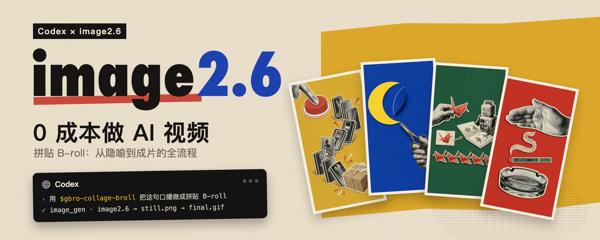
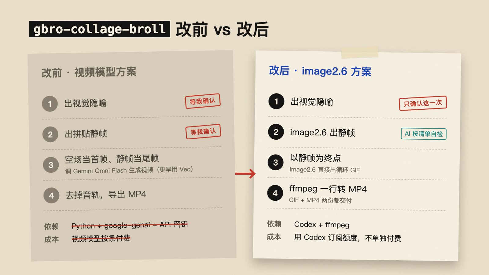
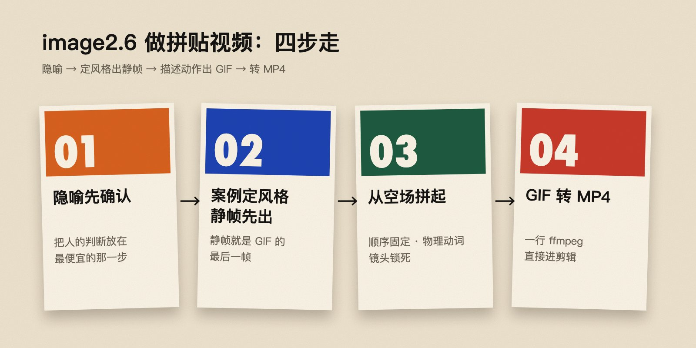
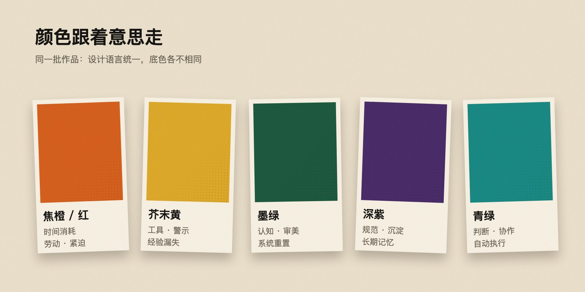

> This article is adapted from [gbroai's long-form post on X](https://x.com/gbroai/status/2118589683819262346). The author demonstrated a personal workflow for turning roughly five seconds of narration into halftone-paper collage B-roll, saying it ran within an existing Codex subscription allowance without calling a video-generation model. That describes the author's tools and quota at the time; it does not guarantee zero marginal cost for every account. Model capabilities, subscription benefits, and access can change. The author also said the updated Skill was still being debugged, so the public repository may not yet contain the workflow shown in the post.



The hard part of making a tactile-looking shot from narration is not simply “making the model animate.” First translate an abstract sentence into a readable scene, establish a repeatable visual language, then constrain the animation to do one thing. gbroai's practice can be summarized as:

```text
Approve a visual metaphor → set the style and generate a still → describe assembly and generate a GIF → convert it to MP4
```

The key idea is to pause for human judgment only where it matters most: approve the metaphor. A checklist can catch style, composition, and fake text issues; the GIF then targets a still frame that has already been approved.

## From a Video Model to a Still-Driven GIF

The author's previous workflow approved a metaphor and then a still, used a plain-color field as the first frame and the still as the last frame, asked a video model to fill the motion between them, and removed the audio afterward. The revised workflow keeps one human approval: an image model creates and checks a still against a style specification, generates a looping GIF toward that still, and then converts it to MP4.

| Stage | Previous approach | Revised approach |
| --- | --- | --- |
| Human approval | Approve both metaphor and still | Focus approval on the visual metaphor |
| Motion generation | A video model interpolates between start and end frames | An image model assembles a still from an empty field as a GIF |
| Dependencies | Python, model SDK, API key, and video model | Codex and ffmpeg; the generation entry point depends on account access |
| Deliverables | MP4 without audio | Both GIF and MP4 |

This does not make GIFs suitable for every video task. They work best for short, looping shots whose subject can be divided into a small number of paper pieces. Complex continuous motion, realistic camera movement, long scenes, and synchronized audio need other production methods.



## Step 1: Translate the Narration into One Metaphor

Narration often expresses an abstract idea. Giving the sentence directly to an image model can produce a random but unfocused result. First rewrite it as a physical scene that viewers can read at a glance. For example, “experience keeps being consumed” might become a hand cutting the same shape out of paper again and again; “standards becoming institutional knowledge” might become loose cards being bound into a book.

Keep the metaphor approval as a human checkpoint because it determines whether the later shot communicates the right idea. Reviewing one sentence costs less than regenerating multiple images and an animation.

- Use one metaphor per sentence; do not make one shot explain three ideas.
- Limit the scene to roughly 3–6 main objects so the subject stays legible and motion has clear layers.
- Keep the spoken script out of the generated image. Let the scene carry the metaphor and captions carry the words.
- When making a batch, connect the shots narratively so each B-roll serves the larger passage.

## Step 2: Define the Visual Specification Before the Still

Adjectives such as “editorial collage” or “premium texture” are hard to reproduce consistently. The author's approach starts from a concrete visual reference, then breaks it into reusable visual parameters, for example in a project file named `visual-spec.json`. That filename is a workflow suggestion, not a fixed format published by the author.

A practical collage specification can state:

- The background is a uniform sheet of solid color with no gradient.
- The subject uses black-and-white halftone photo cutouts with visible print dots.
- Colored paper highlights only a few important objects instead of making every element compete.
- Paper edges are crisp, with a narrow warm-white border and soft shadows.
- Keep subtle paper-fiber grain; avoid polished plastic or smooth 3D surfaces.

The reference helps the model and creator share a visual target; the parameterized specification helps maintain consistency across a batch. Color can also carry meaning: warm reds and oranges for labor or urgency, yellow for tools or warnings, green for collaboration and execution, and darker tones for retention and long-term memory. This is an example from the author's practice, not a universal rule.

The still should also be designed for motion. Keep the subject near the center, reserve a clean region for the animation to begin, and group elements into a few large paper pieces. The more fragmented the composition, the harder the animation is to read.


### Add Negative Constraints and an Acceptance Checklist

Image models may add text that looks plausible but is unreadable, along with fake logos, interface elements, or watermarks. Explicitly rule those out in the prompt and state that the result should not look like a realistic scene or glossy 3D render. After generation, check:

1. Is the metaphor immediately understandable, and is the subject focused?
2. Are there garbled words, fake text, logos, watermarks, or UI?
3. Is there enough clean solid-color space?
4. Is the subject made of a few separable, large paper pieces?
5. Does the batch share a consistent texture while varying color with intention?

Regenerate a still that fails instead of waiting until the GIF stage. Turning visible issues into a checklist reduces manual watching and makes automated review more concrete.

## Why the Still Should Come First

When asked to generate a GIF directly, a model must decide the art direction, composition, and motion at once. That creates too many variables and can lead to drifting images, flickering pieces, or unwanted elements. Once the still is fixed, the motion task only needs to answer: how do the paper pieces assemble from an empty field into this composition?



## Step 3: Describe Assembly Instead of Drift

The author describes the motion approach as `assemble-from-empty`: start with a blank background and assemble the approved still piece by piece. Collage motion comes from discrete actions such as a cutout dropping into place, sliding, snapping, flipping, or being bound. Continuous drifting, breathing, or slow camera pushes can make a looping image feel jittery.

Four rules help describe the motion:

1. **Keep a fixed order:** bring in the background structure, then people or key cards, then connectors, and finally the result. Hold briefly, clear the scene, and return to the empty field for the loop.
2. **Specify four things for each object:** where it enters, what it does, where it stops, and when it leaves.
3. **Use visible physical verbs:** slide in, drop, snap into place, flip, cut, bind, or light up. “Appear” alone does not constrain a specific movement.
4. **Lock the camera and content:** no cuts, zooms, deformation, new objects absent from the still, or added text.

After generation, do not inspect only the ending. Check whether pieces appear too early, whether the middle truly assembles piece by piece, whether the final frame matches the still, and whether the loop jumps at its join. Also inspect transparency or abrupt changes at the actual playback speed.


## Step 4: Convert the GIF to an Editing-Ready MP4

GIFs are convenient for previews on web pages and social platforms, but editing software may not handle their import and frame rate as expected. The author recommends delivering an MP4 as well. This general example reflects the parameters from the post; adjust input filename, aspect ratio, and frame rate to the actual asset:

```bash
ffmpeg -ignore_loop 1 -i input.gif \
  -vf "fps=24,scale=720:1280:force_original_aspect_ratio=decrease,pad=720:1280:(ow-iw)/2:(oh-ih)/2" \
  -an -pix_fmt yuv420p -c:v libx264 output.mp4
```

- `-ignore_loop 1`: ignore the GIF's infinite-loop marker and convert one pass.
- `fps=24`: set a common 24 fps output. If the source GIF and project frame rates differ, review the motion before choosing.
- `scale` and `pad`: resize proportionally and pad to vertical 720×1280 instead of stretching.
- `-pix_fmt yuv420p`: improve compatibility with common players and editing software.
- `-an`: omit audio; handle B-roll sound in the main edit.
- `libx264`: encode H.264 video.

Use `ffprobe` to verify duration, dimensions, frame rate, codec, and audio-track state before importing the file into a timeline. If the source GIF is not vertical, padding may produce an awkward composition. Redesign the canvas or use landscape dimensions instead of assuming padding will always look good.




## When This Method Fits

This approach fits short explanatory shots in spoken videos, visual metaphors that can be divided into paper or card layers, and clips meant to loop on social platforms. It is especially useful when the production process can be standardized: write the visual reference, style parameters, negative constraints, motion order, and output specifications once, then change only the semantic content for each new shot.

It does not guarantee zero cost or reliable output. Even without a per-video generation charge, image generation can use subscription quota, require account eligibility, or depend on additional tools. Prompt iteration, review, and editing also take time. Verify access and quotas with your own account, and treat the author's per-video price as a personal estimate from that moment, not a market quote.

At the time of the post, the author said the open-source [gbro-collage-broll repository](https://github.com/pyang5166/gbro-collage-broll) still contained an earlier Gemini Omni Flash approach and that the image2.6 update was being debugged. Distinguish code already committed to the repository from the experimental workflow in the article; do not assume the README or existing Skill already includes every new feature.

For a series of videos, the most reusable assets are not a single prompt but four stable pieces: a visual reference, a style specification, a still-image checklist, and a motion template. Reserve human judgment for the metaphor and final review, then use written rules for repeated checks. That makes short shots easier to produce in batches while keeping them recognizable.
